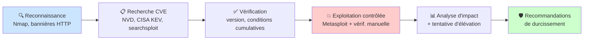
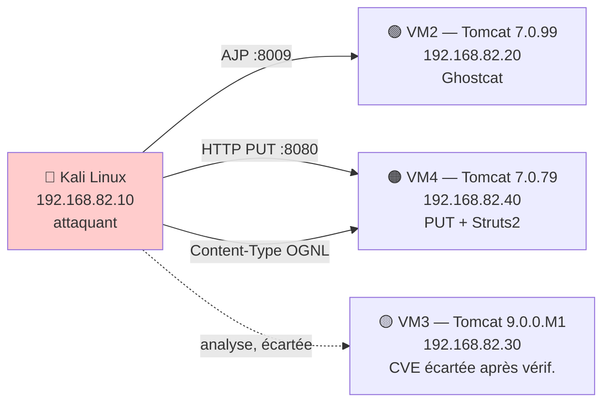

# Apache Tomcat Security Audit & Penetration Test


## Table des matières

- [Présentation](#présentation)
- [Méthodologie](#méthodologie)
- [Laboratoire](#laboratoire)
- [Vulnérabilités exploitées](#vulnérabilités-exploitées)
- [Résultat clé](#résultat-clé)
- [Ma contribution](#ma-contribution)
- [Technologies](#technologies)
- [Structure du dépôt](#structure-du-dépôt)
- [Avertissement](#avertissement)

## Présentation

Audit de sécurité et test d'intrusion structuré mené contre trois instances Apache Tomcat isolées (versions 7.0.99, 7.0.79, et Struts2 2.3.24), dans le cadre d'un stage en cybersécurité. Démarche de **découverte autonome des vulnérabilités** plutôt que de CVE présélectionnée : reconnaissance → recherche CVE → vérification des conditions → exploitation contrôlée → recommandations.

## Méthodologie



Alignée sur le framework **MITRE ATT&CK** (T1595 — Reconnaissance, T1190 — Exploit Public-Facing Application).

## Laboratoire



Chaque CVE a été étudiée sur une **instance dédiée** pour éviter toute interférence de configuration.

## Vulnérabilités exploitées

| CVE | CVSS | Vecteur | Résultat |
|---|---|---|---|
| **CVE-2020-1938** (Ghostcat) | 9.8 — Critique | Connecteur AJP détourné | Lecture de fichier arbitraire |
| **CVE-2017-12615** | 8.1 — Élevée | Méthode HTTP PUT (WebDAV) | Exécution de code à distance |
| **CVE-2017-5638** (Struts2) | 10.0 — Critique | Injection OGNL dans `Content-Type` | Exécution de code à distance |

Chaque exploitation est documentée par **double preuve indépendante** : sortie Metasploit + vérification manuelle depuis un terminal distinct (`id`, `getuid`, fichier horodaté relu).

## Résultat clé

Les deux RCE ont abouti au **même utilisateur applicatif** (`tomcat`, sans droits `sudo`). Une recherche méthodique d'élévation de privilèges (84 modules testés via `local_exploit_suggester`) n'a abouti à aucun résultat exploitable sans condition artificielle.

> Ce résultat démontre concrètement l'efficacité du **principe du moindre privilège** : deux RCE critiques (CVSS 8.1 et 10.0) sont restées contenues au périmètre applicatif, sans atteindre le système sous-jacent.

## Ma contribution

| Tâche | Détail |
|---|---|
| Lab | 4 VM isolées, réseau Host-Only, comptes de service dédiés |
| Recherche CVE | Triage autonome — CVE écartées documentées avec justification (ex. CVE-2024-50379) |
| Exploitation | Ghostcat, CVE-2017-12615, Struts2/OGNL — chacune avec double preuve |
| Post-exploitation | Tentative d'élévation de privilèges (manuelle + automatisée) |
| Rapport | Recommandations de durcissement liées à chaque CVE |

## Technologies

`Kali Linux` `Metasploit Framework` `msfvenom` `Nmap` `Apache Tomcat` `Apache Struts2` `NVD` `CISA KEV`

## Structure du dépôt

```
docs/                             → méthodologie détaillée, captures d'écran
findings/                         → une fiche par CVE exploitée
remediation-recommendations.md    → mesures correctives et durcissement
```

## Avertissement

Test réalisé exclusivement dans un laboratoire virtuel isolé, à des fins académiques (PFA). Aucune infrastructure réelle n'a été ciblée.
